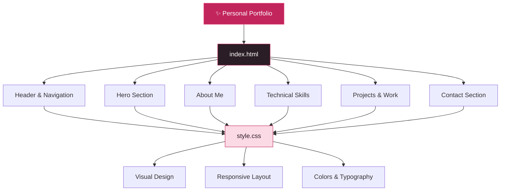

# ✨ Sanhita Bhattacharjee
### Personal Portfolio | CSE Undergraduate | Web Developer | Cybersecurity Enthusiast

<p align="center">
  
</p>

<p align="center">
  <strong>Building the Web. Exploring Security. Creating with Purpose.</strong>
</p>

<p align="center">
  A personal portfolio website showcasing my introduction, technical skills, interests, projects, and contact information.
</p>

<p align="center">
  <a href="https://github.com/Sanhita2006">
    
  </a>
  <a href="https://www.linkedin.com/in/sanhita-bhattacharjee-896283397">
    
  </a>
  <a href="mailto:sanghitab2006@gmail.com">
    
  </a>
</p>

---

## 📌 Table of Contents

- [About the Project](#-about-the-project)
- [About Me](#-about-me)
- [Website Sections](#-website-sections)
- [Technical Skills](#-technical-skills)
- [Design & User Experience](#-design--user-experience)
- [Technology Stack](#-technology-stack)
- [Project Structure](#-project-structure)
- [Getting Started](#-getting-started)
- [Key Highlights](#-key-highlights)
- [Future Improvements](#-future-improvements)
- [License](#-license)
- [Contact](#-contact)

---

## 🌸 About the Project

**Sanhita_Portfolio** is my personal portfolio website, created to introduce myself as a Computer Science and Engineering undergraduate student with interests in Web Development and Cybersecurity.

The website serves as a digital space where visitors can learn about my background, explore my technical skills, understand my interests, and connect with me professionally.

It features a clean, minimal, and modern design with a pink-and-white color palette, smooth navigation, responsive layouts, and dedicated sections for personal and professional information.

### 🎯 Project Objectives

- Build a professional online presence.
- Showcase my technical skills and learning journey.
- Present my interests in Web Development and Cybersecurity.
- Make my GitHub and LinkedIn profiles easily accessible.
- Create a foundation for showcasing future projects and achievements.

---

## 👩‍💻 About Me

Hello! I'm **Sanhita Bhattacharjee**, a Computer Science and Engineering undergraduate student passionate about technology, Web Development, and Cybersecurity.

I enjoy exploring how websites and applications are built and learning how to make them more secure against modern vulnerabilities.

My goal is to combine software development and cybersecurity knowledge to create functional, user-friendly, and secure digital solutions.

**My Interests:**

- 🌐 Web Development
- 🛡️ Cybersecurity
- 💻 Programming
- 🔐 Secure Web Applications
- 🚀 Learning New Technologies
- 🧩 Building Practical Projects

---

## ✨ Website Sections

### 01. 🏠 Home / Hero Section

The main introduction section of the portfolio.

- Personal introduction.
- Professional tagline.
- Open to Work indicator.
- Email Me button.
- GitHub profile link.
- LinkedIn profile link.
- JavaScript security-themed code illustration.

### 02. 🌷 About Me

A dedicated section introducing my educational background, technical interests, and career goals.

- Computer Science & Engineering background.
- Interest in Cybersecurity.
- Interest in Web Development.
- Focus on continuous learning and improvement.

### 03. 🛠️ Technical Skills

A categorized presentation of my technical skills.

**Programming Languages**
- C
- Python
- JavaScript

**Web Development**
- HTML
- CSS
- JavaScript

**Currently Learning**
- Cybersecurity

### 04. 🚀 Projects & Work

A dedicated section for exploring my development work.

- GitHub profile integration.
- Access to project repositories.
- Space for showcasing future projects.

### 05. 📬 Contact Section

A simple and accessible way to connect with me.

- Email contact.
- LinkedIn profile.
- GitHub profile.

---

## 🎨 Design & User Experience

The portfolio follows a clean and minimal visual design.

**Design highlights:**

- Pink and white color palette.
- Clean typography using Plus Jakarta Sans.
- Rounded UI elements and modern cards.
- Sticky navigation header.
- Smooth scrolling navigation.
- Responsive layout for different screen sizes.
- Accessible focus indicators.
- Dedicated code illustration section.

---

## 🧰 Technology Stack

<p align="center">
  
</p>

| Technology | Purpose |
|---|---|
| HTML5 | Website structure and content |
| CSS3 | Styling, layout, and responsiveness |
| Google Fonts | Plus Jakarta Sans typography |
| Git | Version control |
| GitHub | Source code hosting |

**Additional concepts demonstrated:**
- Semantic HTML.
- CSS Grid and Flexbox.
- CSS Custom Properties.
- Responsive Media Queries.
- HTML Entity Escaping in JavaScript.

---

## 🏗️ Website Architecture

The portfolio uses a simple static website architecture.



---

## 📂 Project Structure

```text
Sanhita_Portfolio/
│
├── index.html       # Main portfolio webpage
│
├── style.css        # Styling and responsive design
│
├── README.md        # Project documentation
│
├── LICENSE          # MIT License
│
└── .gitignore       # Git ignored files
```

---

## ⚙️ Getting Started

Follow these steps to run the portfolio on your local machine.

### Prerequisites

- A modern web browser.
- Git (optional, for cloning).
- Visual Studio Code (recommended).

### Step 1: Clone the Repository

```bash
git clone https://github.com/Sanhita2006/Sanhita_Portfolio.git
```

### Step 2: Navigate to the Project Folder

```bash
cd Sanhita_Portfolio
```

### Step 3: Open in Visual Studio Code

```bash
code .
```

### Step 4: Run the Website

Open `index.html` directly in your browser.

Alternatively, use the Live Server extension in Visual Studio Code for a local development preview.

---

## 🌟 Key Highlights

| Area | Highlights |
|---|---|
| Design | Minimal pink-and-white theme |
| Navigation | Sticky navigation with section links |
| Layout | Responsive CSS Grid and Flexbox |
| Typography | Plus Jakarta Sans |
| Accessibility | Semantic elements and focus indicators |
| Security Concept | JavaScript HTML escaping example |
| Contact | Email, GitHub, and LinkedIn integration |

---

## 🔮 Future Improvements

I plan to continuously improve this portfolio as I develop new skills and work on more projects.

- [ ] Add individual project showcase cards.
- [ ] Add project live-demo links.
- [ ] Include GitHub repository links for each project.
- [ ] Add certifications and achievements.
- [ ] Add education and learning journey timeline.
- [ ] Introduce a dedicated cybersecurity projects section.
- [ ] Add a downloadable resume.
- [ ] Improve portfolio interactions and animations.
- [ ] Expand the portfolio with new projects and technical achievements.

---

## 📜 License

This project is licensed under the **MIT License**.

See the [LICENSE](./LICENSE) file for more information.

---

## 📬 Contact

I'm always interested in connecting with developers, learning new technologies, and exploring opportunities to collaborate on interesting projects.

<p align="center">
  <a href="mailto:sanghitab2006@gmail.com">
    
  </a>
</p>

<p align="center">
  <a href="https://github.com/Sanhita2006">
    
  </a>
  <a href="https://www.linkedin.com/in/sanhita-bhattacharjee-896283397">
    
  </a>
</p>

---

<p align="center">
  <strong>✨ Designed & Developed by Sanhita Bhattacharjee</strong>
</p>

<p align="center">
  <i>Learning Today. Building Tomorrow. Securing the Future. 🛡️</i>
</p>

<p align="center">
  
</p>
